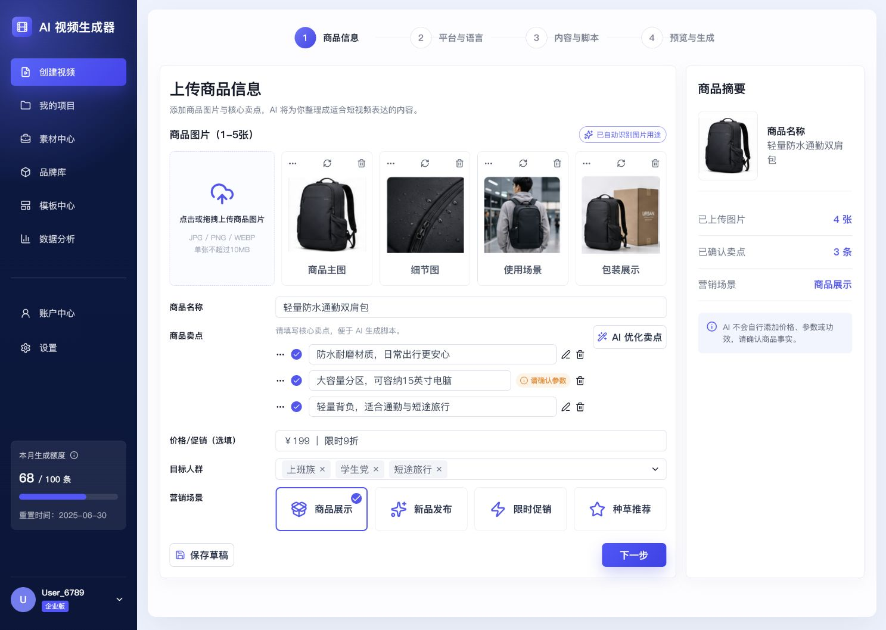
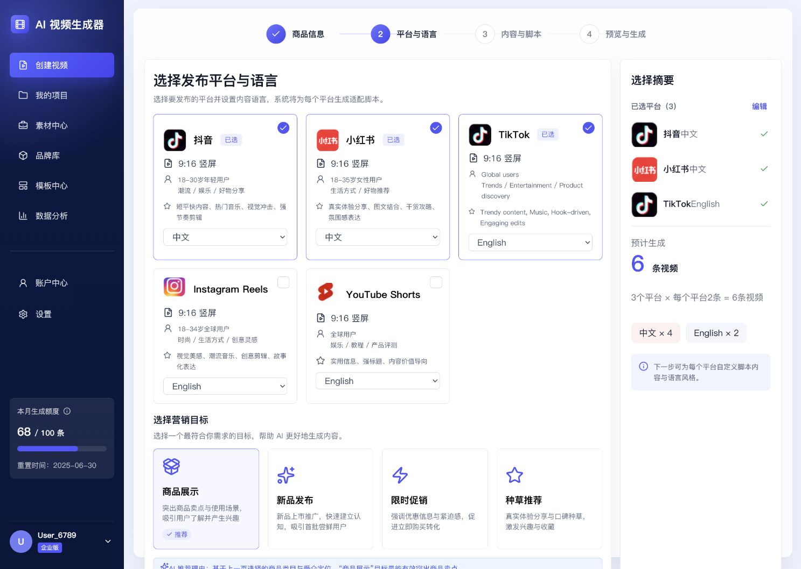
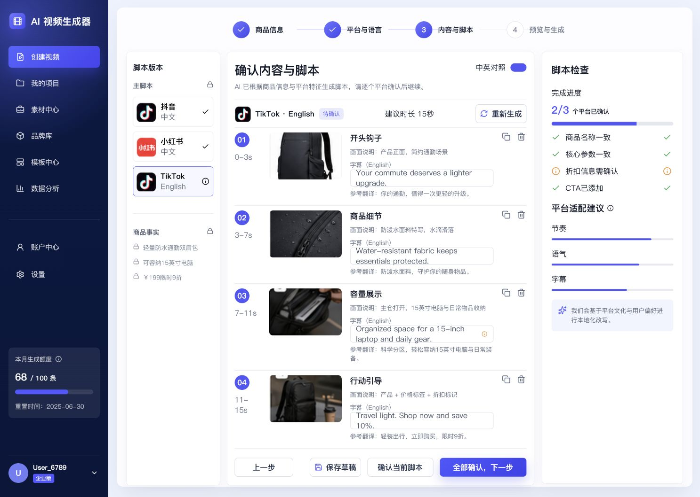
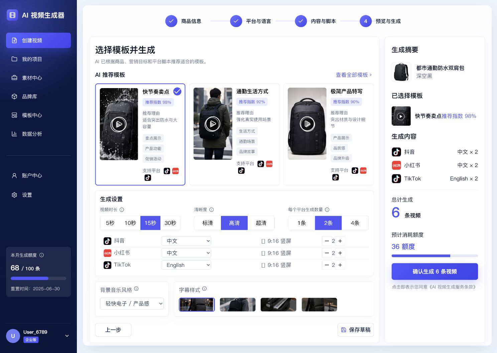
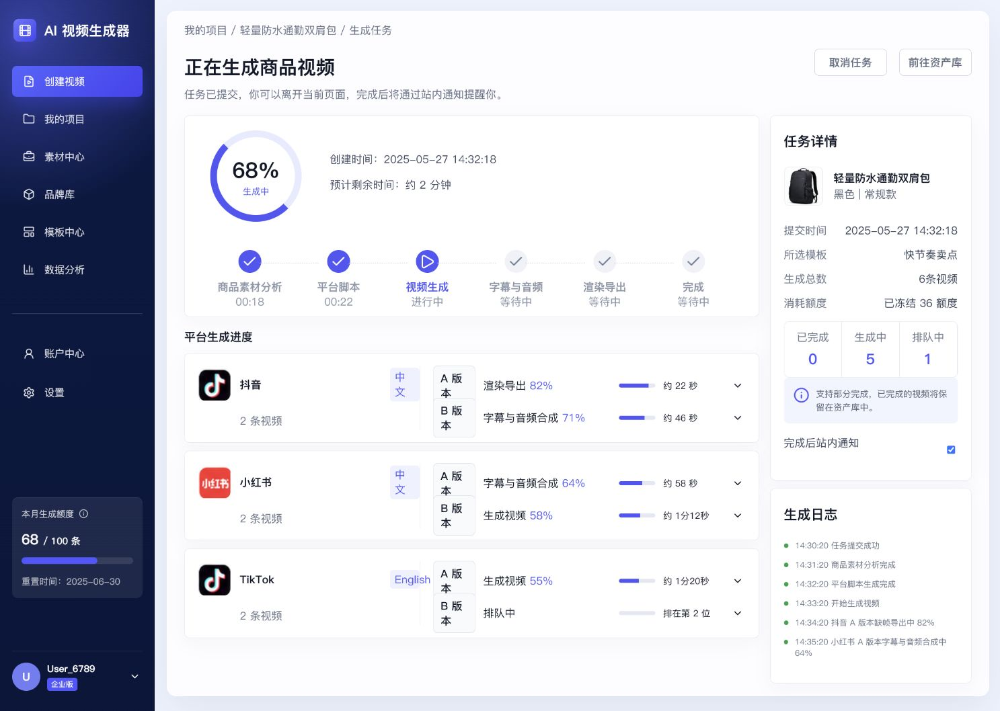
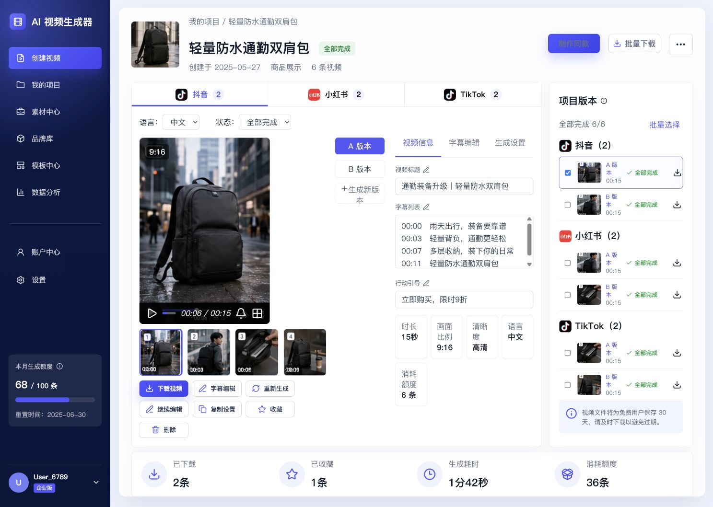

# AI 电商短视频生产工作台 · 高保真原型

> **AI Ecommerce Video Workbench — High-fidelity Interactive Prototype**
> 把一份可信的商品事实，持续派生多平台、多语言、可复用的营销视频版本。

**English abstract:** This is a high-fidelity interactive prototype (React + Vite) of an AI-powered e-commerce short-video production workbench. Instead of competing on "image-to-video" generation (which is already a commodity feature), the product is organized around a **trustworthy product-fact → master script → multi-platform / multi-language versions → reusable assets** production workflow. It targets e-commerce sellers and cross-border content teams on Douyin, Xiaohongshu (RED), TikTok, Instagram Reels and YouTube Shorts.

---

## 为什么做这个产品（产品定位）

竞品调研（见 [docs/competitive-analysis.md](docs/competitive-analysis.md)）发现：图生视频、模板、字幕、数字人、AI 文案已逐渐成为行业标配，继续强调"一键成片"难以形成差异。更有价值的切入点是：

> **从"一次生成一条视频"，升级为"一份可信的商品信息，持续派生多平台、多语言、可复用的视频版本"。**

本原型的三个核心价值支柱：

| 价值支柱 | 含义 | 原型中的体现 |
|---|---|---|
| **可信** | 商品事实与 AI 推测分离，高风险字段人工确认 | 卖点来源标注、AI 不改写数字/价格、脚本先确认后生成、失败额度自动退回 |
| **多平台** | 主脚本显式派生平台脚本，差异不仅是画幅 | 抖音/小红书/TikTok 独立脚本、节奏/语气/字幕差异化、中英双语对照 |
| **可复用** | 成功结果沉淀为可重复生产的方法 | "制作同款"强制替换商品事实、模板中心、资产库与项目聚合 |

---

## 核心工作流（六步）

```
上传商品信息 → 平台与语言 → 内容与脚本确认 → 模板与生成设置 → 正在生成 → 结果与再编辑
```

| 步骤 | 说明 | 截图 |
|---|---|---|
| 01 商品信息 | 上传 1-8 张商品图（自动识别用途）、填写卖点，AI 卖点优化建议可逐条采用；数字/价格/参数不会被自动改写 |  |
| 02 平台与语言 | 选择目标平台（抖音/小红书/TikTok 等）与语言（中文/English），多平台任务聚合到同一商品项目 |  |
| 03 内容与脚本 | 主脚本 → 平台脚本显式派生，逐平台确认；中英事实对照检查、商品名称/参数/折扣/CTA 逐项核对 |  |
| 04 模板与生成 | 模板推荐（含推荐指数与适用场景）、时长/清晰度/生成数量设置；时长修改触发脚本适配提示 |  |
| 05 正在生成 | 按平台 × 语言 × A/B 版本展示进度，失败平台可独立重试、额度自动退回 |  |
| 06 结果与再编辑 | 平台版本 Tab、A/B 版本切换、字幕编辑、下载/收藏/删除、复制设置、制作同款（强制替换商品事实） |  |

> 截图基于 1487 × 1058 设计画布；完整 49 张全模块截图归档见 [docs/screenshots-archive/](docs/screenshots-archive/)。

---

## 功能模块一览

| 模块 | 页面/交互 | 覆盖的产品能力 |
|---|---|---|
| 首页 | 快捷入口、最近项目、推荐模板、额度与洞察卡片 | 任务入口、额度可视化 |
| 项目与资产 | 全部项目、生成中、已完成、收藏/已下载、回收站 | 项目聚合、批量选择、失败重试、30 天回收策略 |
| 创建视频（核心流程） | 六步工作流 + 商品素材管理弹窗、AI 卖点建议面板、脚本二次确认、重新生成脚本 | 事实确认、多平台派生、脚本治理 |
| 结果页 | 平台 Tab、A/B 版本、字幕编辑、视频信息、项目版本列表 | 再编辑、批量下载、同款复用 |
| 制作同款 | 新商品信息页 + 商品事实替换提醒弹窗 | 结构复用 + 事实防错继承 |
| 模板中心 | 模板/特效/工作流分类、示例预览、试用当前商品 | 少而有效的模板策略 |
| 通知中心 | 生成完成、部分完成、失败/异常、额度变动、到期提醒 | 异步任务可理解性 |
| 账户中心 | 账户资料、额度详情、模型设置、通知偏好、数据与隐私 | 额度/模型/隐私管理 |

---

## 技术栈

- **React 19** + **Vite 6**（ESM、ESBuild 优化）
- **lucide-react** 图标库
- 原生 CSS Modules 式全局样式（`src/styles.css`），锁定 1487 × 1058 设计画布
- 纯前端 Mock 数据，无后端依赖，可直接静态部署

---

## 目录结构

```
ecommerce-video-prototype/
├── src/                        # 原型源码
│   ├── App.jsx                 # 全部页面与交互逻辑（单文件高保真原型）
│   ├── main.jsx                # 入口
│   └── styles.css              # 全局样式与设计令牌
├── public/
│   └── assets/                 # 商品图、平台 Logo、模板封面等静态素材
├── docs/                       # 作品集配套文档
│   ├── competitive-analysis.md # 竞品分析（WeShop / Pic Copilot / Pippit / 万相营造 / 即创 / 剪映）
│   ├── design-qa.md            # 设计 QA 记录与修复过程
│   ├── design-sources/         # 六屏设计源图（视觉真值）
│   ├── qa-screenshots/         # 重建实现截图（README 使用）
│   └── screenshots-archive/    # 49 张全模块用户端截图归档 + 索引
├── .github/workflows/          # GitHub Pages 自动部署
├── index.html
├── package.json
└── vite.config.mjs             # base: "./" 兼容 Pages 子路径与本地 file:// 预览
```

---

## 快速开始

```bash
# 安装依赖
npm install

# 本地开发（http://localhost:5173）
npm run dev

# 生产构建（输出到 dist/）
npm run build

# 本地预览构建产物（http://localhost:4173）
npm run preview
```

> 无需后端与 API Key，全部为前端 Mock 数据，clone 即可运行。

---

## 部署到 GitHub Pages

仓库已内置 GitHub Actions 工作流（`.github/workflows/deploy-pages.yml`），推送到 `main` 分支后自动构建并发布。启用步骤：

1. 将本仓库推送到 GitHub（`git push -u origin main`）；
2. 进入仓库 **Settings → Pages**，将 **Source** 选择为 **GitHub Actions**；
3. 等待一次构建完成，即可通过 `https://<用户名>.github.io/<仓库名>/` 访问在线演示。

> `vite.config.mjs` 已设置 `base: "./"`，产物在子路径与本地 `file://` 打开下均可用。

---

## 相关文档

- [产品 PRD：AI 商品短视频生成工作台](docs/prd-workbench.md) —— 用户端需求范围与核心流程定义
- [平台运营后台 PRD](docs/prd-platform-admin.md) —— 运营后台模块与经营数据设计
- [竞品分析与差异化定位](docs/competitive-analysis.md) —— 三类竞争力量、能力对比矩阵、MVP 策略与验证指标
- [设计 QA 记录](docs/design-qa.md) —— 模块化重建过程、对齐修复与验收结果
- [全模块截图归档](docs/screenshots-archive/截图目录.md) —— 49 张用户端原型图与索引

---

## License

[MIT](LICENSE) © 2026 齐文圣 (Wensheng Qi)
