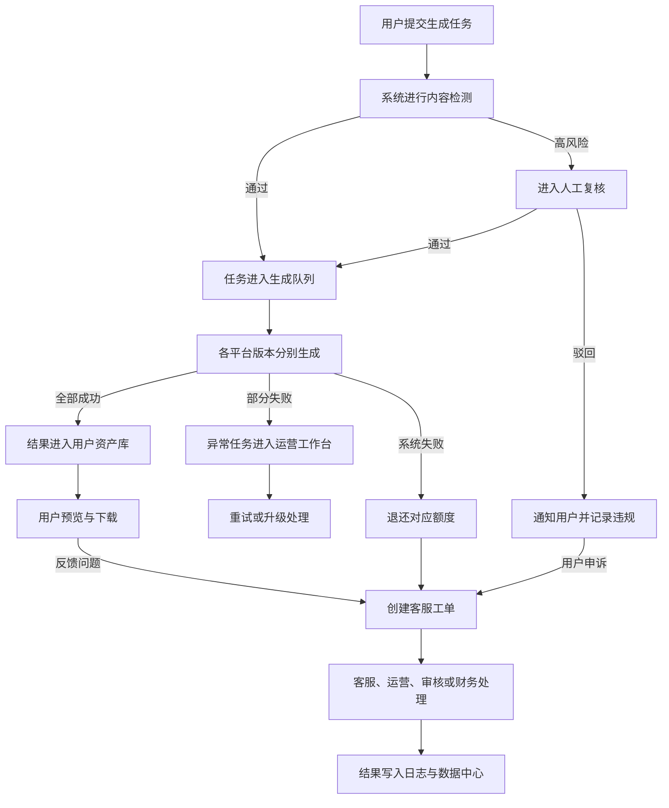

# AI 商品短视频平台运营后台产品需求文档

## 1. 文档概述

本文档定义 AI 商品短视频平台的内部运营后台。后台面向平台运营、内容审核、内容运营、客服、财务运营、数据分析和系统管理员，覆盖用户管理、生成任务、内容风控、模板运营、额度与订单、客服工单、经营数据和系统配置。

后台按照业务生命周期组织，优先建立“任务可追踪、风险可处置、额度可核对、操作可审计”的运营与风控闭环，再逐步完善内容运营和商业化能力。

### 1.1 产品名称

AI 商品短视频平台运营后台

### 1.2 产品形态

内部使用的网页端管理工作台。

### 1.3 关联产品

面向电商商家、跨境卖家与内容营销团队的 AI 商品短视频生成工作台。

---

## 2. 建设背景

用户在商品短视频工作台中上传商品图片和卖点，选择目标平台与语言，经 AI 生成脚本、模板和视频。随着用户量、任务量和付费规模增长，平台需要解决以下内部管理问题：

1. 无法快速定位排队、超时、部分成功和生成失败任务。
2. 商品图片、卖点、脚本、字幕和成片可能包含违规或侵权内容。
3. 用户额度扣除、失败退还和客服补偿需要统一核对。
4. 模板、分类、推荐位和多语言内容缺少稳定的发布流程。
5. 用户投诉、审核申诉和退款申请缺少统一工单闭环。
6. 套餐、订单、退款、水印和经营数据需要集中管理。
7. 高风险操作缺少权限隔离、审批和完整审计。

因此，需要建设独立的平台运营后台，保障生成服务稳定、内容安全、用户权益准确，并支持内容增长和商业化运营。

---

## 3. 产品目标

### 3.1 核心目标

1. 建立从用户提交任务到视频生成、审核、下载和售后处理的完整运营链路。
2. 让异常任务能够被及时发现、定位、重试、退款和追踪。
3. 让违规内容能够通过机器检测与人工复核完成处置和申诉。
4. 让模板、分类、推荐位和多语言内容能够按统一流程运营。
5. 让套餐、额度、订单、退款和水印权益保持一致。
6. 让所有敏感操作具备权限控制、审批和审计记录。

### 3.2 设计原则

- **按业务生命周期组织**：围绕用户、任务、审核、内容、商业化和售后展开。
- **异常优先**：工作台优先呈现需要人工介入的事项。
- **AI 推荐，人工决策**：机器负责识别和建议，关键处置由授权人员确认。
- **最小权限**：不同角色只获得完成职责所需的权限。
- **全程留痕**：补偿、退款、封禁、下架和配置修改必须记录。
- **部分成功可处理**：多平台任务按子任务分别追踪，不将部分失败简单视为整单失败。
- **商业事实不可随意修改**：后台人员不得直接篡改用户已提交的商品事实和生成参数。

---

## 4. 用户角色与权限

| 角色 | 主要职责 | 主要权限 |
|---|---|---|
| 超级管理员 | 平台最高权限管理 | 全部模块、角色权限、系统配置和审计 |
| 平台运营 | 保障日常运营和任务稳定 | 用户、任务、异常、模板及基础运营管理 |
| 内容审核 | 处理内容风险 | 审核、驳回、下架、复核和申诉处理 |
| 内容运营 | 管理平台内容供给 | 模板、分类、推荐位、标签和多语言内容 |
| 客服 | 处理用户问题 | 用户查询、工单、补偿申请和退款申请 |
| 财务运营 | 管理资金与权益核对 | 订单、退款、额度核对和经营数据 |
| 数据分析 | 支持运营决策 | 数据查看与授权范围内的数据导出 |

### 4.1 高风险操作

以下操作需要二次确认、审批或更高权限：

- 大额额度补偿或人工扣减；
- 用户冻结、封禁或注销；
- 批量下架模板；
- 违规内容永久删除；
- 退款审核与执行；
- 套餐价格和权益修改；
- 敏感用户数据导出；
- 模型服务、审核规则和告警规则修改。

### 4.2 权限粒度

权限至少区分：

```text
查看
编辑
审核
发布
下架
补偿
退款
导出
系统配置
```

同一笔退款的申请、审核和执行，不应由同一角色独立完成。

---

## 5. 信息架构

```text
平台运营后台
│
├── 工作台
├── 用户与账户
├── 生成任务
├── 内容审核
├── 模板与内容
├── 额度与商业化
├── 客服与工单
├── 数据中心
└── 系统管理
```

后台采用左侧固定导航。导航根据角色权限显示，未授权模块不展示或不可访问。

---

## 6. 第一优先级：运营与风控闭环

第一优先级保障平台能够稳定运行、及时处理异常、控制内容风险，并准确维护用户权益。

### 6.1 工作台

#### 页面目标

集中展示平台运行情况、异常风险和运营待办，让不同角色进入后台后首先看到需要处理的事项。

#### 核心指标

- 今日新增用户、活跃用户和付费用户；
- 今日生成任务数、成功率、失败率和平均生成时长；
- 排队中、超时、部分成功和失败任务数量；
- 待审核、待复核和高风险内容数量；
- 今日额度消耗、失败退还和人工补偿；
- 模型服务、审核服务和存储服务告警。

#### 待办事项

- 待人工复核内容；
- 待处理异常任务；
- 待审批额度补偿；
- 待审核退款；
- 待处理用户申诉；
- 即将过期的模板或运营内容。

#### 交互规则

- 指标卡片可以点击并跳转至对应筛选列表。
- 异常指标按风险等级排序。
- 不同角色看到与职责相关的待办。
- 高风险告警需要显示发现时间、影响范围和当前负责人。

### 6.2 用户与账户

#### 用户列表

支持按以下条件筛选：

- 用户编号、手机号或邮箱；
- 注册时间、来源和最近活跃时间；
- 免费用户或会员用户；
- 正常、冻结、封禁或注销状态；
- 风险等级和违规次数；
- 额度余额和存储使用情况。

#### 用户详情

展示：

- 基础账户信息；
- 当前套餐、会员有效期和剩余额度；
- 商品项目、生成任务和下载记录；
- 登录设备和异常登录记录；
- 内容违规记录和风险等级；
- 额度流水、订单和退款记录；
- 客服工单与历史处置记录。

#### 管理操作

- 冻结、解冻、封禁和注销账户；
- 人工增加、扣减、冻结或解冻额度；
- 标记风险用户；
- 查看关联任务、订单、审核和工单；
- 添加内部备注。

#### 规则

- 冻结或封禁必须填写原因和有效期。
- 额度人工调整必须记录调整前后余额。
- 客服只能提交补偿申请，超过阈值后由平台运营审批。
- 所有操作记录操作人、时间、原因和结果。

### 6.3 生成任务

#### 任务生命周期

```text
待提交
→ 排队中
→ 素材分析
→ 脚本生成
→ 视频生成
→ 字幕与音频合成
→ 渲染导出
→ 全部完成 / 部分完成 / 失败 / 已取消
```

#### 列表筛选

- 用户、商品名称和项目编号；
- 目标平台和语言；
- 任务状态和失败原因；
- 模板、模型服务和规则版本；
- 创建时间、完成时间和任务耗时；
- 预计额度、实际消耗和退还额度。

#### 任务详情

展示：

- 商品图片、名称、卖点和促销信息；
- 主脚本及各平台适配脚本；
- 目标平台、语言、模板和视频参数；
- 各平台子任务状态；
- 各阶段开始时间、结束时间和耗时；
- 模型、模板、审核规则和水印版本；
- 错误信息、重试次数和额度处理结果；
- 任务操作日志。

#### 管理操作

- 重试单个平台失败任务；
- 取消尚未进入生成阶段的任务；
- 对系统失败任务发起额度退还；
- 查看技术日志和错误上下文；
- 批量处理相同原因的异常任务；
- 将任务升级给技术或风控人员。

#### 关键规则

- 多平台任务必须分别记录子任务状态。
- 部分平台失败时，整单显示为“部分完成”。
- 只退还失败平台或失败视频对应的额度。
- 后台人员不能修改已提交任务中的商品事实。
- 如需调整内容，应复制为新任务并重新提交。

### 6.4 内容审核

#### 审核范围

- 商品图片；
- 商品名称和卖点；
- 价格、折扣和活动信息；
- AI 生成脚本；
- 中英文字幕和行动引导；
- 最终生成视频；
- 品牌、肖像和版权素材。

#### 审核流程

```text
待审核
→ 机器审核通过 / 机器审核拦截
→ 待人工复核
→ 人工通过 / 人工驳回
→ 用户申诉
→ 申诉完成
```

#### 风险类型

- 违法违规内容；
- 虚假商品功能或夸大宣传；
- 禁售或限制销售商品；
- 商标、图片、音乐和视频侵权；
- 医疗、美妆等敏感功效表达；
- 虚假价格、折扣和活动信息；
- 未授权肖像或人物素材；
- 不适宜公开展示的内容。

#### 审核页面

应同时展示：

- 原始素材和生成内容；
- 机器审核风险标签；
- 命中的文字、画面或时间点；
- 风险等级和审核依据；
- 用户历史违规记录；
- 当前审核时限。

#### 审核操作

- 通过；
- 驳回并选择原因；
- 下架已生成内容；
- 升级复核；
- 批量处理同类内容；
- 加入敏感词、黑名单或规则样本；
- 处理用户申诉。

#### 关键规则

- 驳回必须选择标准原因并支持补充说明。
- 高风险内容必须由人工复核。
- 审核记录不得被普通运营修改或删除。
- 申诉处理人原则上不应是首次驳回人员。

### 6.5 系统管理

#### 功能范围

- 管理员账户；
- 角色与权限；
- 菜单权限和数据权限；
- 登录日志和操作日志；
- 业务参数配置；
- 通知和告警规则；
- 模型服务配置；
- 数据导出审批。

#### 模型服务管理

- 服务名称和用途；
- 当前状态和健康情况；
- 服务启停和流量切换；
- 超时、重试和降级规则；
- 不同任务阶段使用的服务版本；
- 变更记录和回滚入口。

#### 审计要求

以下信息至少保存：

- 操作人；
- 操作时间；
- 操作对象；
- 操作类型；
- 修改前内容；
- 修改后内容；
- 操作原因；
- 审批人和审批结果。

---

## 7. 第二优先级：内容运营与用户服务

### 7.1 模板管理

#### 模板字段

- 模板名称、封面和动态预览；
- 营销场景；
- 商品品类；
- 适用平台和语言；
- 视频时长、比例和清晰度；
- 分镜结构、字幕样式和行动引导位置；
- 镜头运动和音乐风格；
- 模板版本、状态和发布时间；
- 使用次数、生成成功率和下载率。

#### 模板状态

```text
草稿 → 待审核 → 已发布 → 已下架 → 已归档
```

#### 管理操作

- 创建、复制和编辑模板；
- 预览和审核；
- 立即发布或定时发布；
- 下架、归档和版本回滚；
- 设置推荐标签；
- 查看使用与转化数据。

### 7.2 推荐位与分类管理

管理首页、热门模板、新品模板和品类专区中的推荐内容。

主要功能：

- 推荐位置和排序；
- 生效时间和结束时间；
- 定时发布和自动下线；
- 可见用户范围；
- 推荐原因；
- 曝光、点击、使用和下载数据；
- 发布前效果预览。

推荐位修改应先保存为草稿，确认后再发布，避免直接影响全部用户。

### 7.3 商品品类与标签

管理：

- 一级和二级商品品类；
- 商品展示、新品发布、限时促销和种草推荐等营销场景；
- 目标人群、平台、语言和风格标签；
- 品类与模板的推荐关系；
- 标签的启用、停用和排序。

已被模板或任务引用的品类和标签不允许直接删除，只能停用。

### 7.4 多语言内容管理

首版管理中文和英文内容，包括：

- 模板名称和说明；
- 默认开头钩子；
- 行动引导文案；
- 平台语气规则；
- 敏感词和禁用表达；
- 翻译状态、审核状态和缺失翻译提醒。

多语言运营内容只管理平台提供的模板文案和规则，不修改用户的商品事实。

### 7.5 客服与工单

#### 工单来源

- 用户反馈；
- 生成失败；
- 额度争议；
- 退款申请；
- 审核申诉；
- 视频质量问题；
- 资产保存或下载问题。

#### 工单状态

```text
待分配 → 处理中 → 等待用户回复 → 已解决 → 已关闭
```

#### 工单详情

关联：

- 用户；
- 商品项目；
- 生成任务；
- 订单和额度流水；
- 审核记录；
- 历史沟通和附件。

#### 客服操作

- 查询用户和任务信息；
- 重新发送通知；
- 发起任务重试申请；
- 提交额度补偿或退款申请；
- 升级给运营、审核、财务或技术人员。

客服不得绕过审批直接执行大额补偿或退款。

### 7.6 基础数据中心

提供以下数据：

- 用户新增、活跃和留存；
- 新建视频到下载的核心漏斗；
- 脚本确认率和模板选择情况；
- 生成成功率、失败原因和平均耗时；
- 多平台版本完成率；
- 视频下载率和制作同款使用率；
- 模板曝光、点击、使用和下载表现；
- 不同平台、语言和品类的效果对比；
- 额度消耗和会员转化。

支持按时间、平台、语言、品类、模板和套餐筛选。

---

## 8. 第三优先级：商业化管理

### 8.1 套餐与权益

管理套餐名称、价格、有效期、每月额度、视频清晰度、最长时长、平台数量、生成数量、无水印权益、保存期限和任务优先级。

关键规则：

- 套餐修改不影响用户当前购买周期内的权益；
- 下架套餐不影响已购买用户；
- 权益变更必须保留版本和操作记录。

### 8.2 额度管理

额度流水类型包括：

- 注册赠送；
- 每月免费额度；
- 会员套餐发放；
- 额度包购买；
- 视频生成消耗；
- 系统失败退还；
- 客服补偿；
- 风控冻结与解冻；
- 额度过期。

后台支持查询、人工调整、批量发放、异常核对和流水导出。人工操作必须填写原因并进入审计日志。

### 8.3 订单与支付

管理订单编号、用户、套餐或额度包、支付金额、支付渠道、支付状态、权益发放和退款状态。

订单状态：

```text
待支付 → 支付中 → 支付成功 → 权益已发放
                         ↓
                    退款处理中 → 已退款
```

重点处理支付成功但权益未到账、重复支付、重复发放和订单状态不一致等异常。

### 8.4 退款审批

```text
客服或运营提交申请
→ 系统校验订单和权益使用情况
→ 财务运营审核
→ 执行退款
→ 回收权益或扣回额度
→ 通知用户
→ 记录结果
```

区分全额退款和部分退款。退款失败必须进入异常队列，不得直接标记为完成。

### 8.5 水印管理

支持配置水印图片、位置、透明度、尺寸、展示时段、尾帧标识、适用套餐和生效时间。

支持预览、定时生效、紧急停用和历史版本回滚。系统记录每条视频使用的水印版本。

### 8.6 收入与经营数据

展示：

- 订单数量和支付金额；
- 会员新增、续费和到期；
- 额度包销售情况；
- 付费用户和付费转化；
- 套餐收入和退款率；
- 免费与付费额度消耗；
- 单条视频平均消耗；
- 生成成本与收入趋势。

本模块用于经营分析，不代替正式财务核算系统。

### 8.7 商业化异常

重点监控：

- 支付成功但权益未到账；
- 订单与支付渠道状态不一致；
- 重复发放会员或额度；
- 退款成功但权益未回收；
- 额度重复扣除或退还；
- 套餐到期但权益仍有效；
- 免费用户获得无水印下载；
- 水印配置未生效；
- 异常高频购买、退款或额度消耗。

---

## 9. 完整后台菜单

```text
平台运营后台
│
├── 1. 工作台
│   ├── 核心数据概览
│   ├── 待办事项
│   ├── 任务异常
│   ├── 风控预警
│   └── 额度与服务告警
│
├── 2. 用户与账户
│   ├── 用户列表
│   ├── 用户详情
│   ├── 账户状态管理
│   ├── 风险用户
│   ├── 用户额度
│   └── 用户操作记录
│
├── 3. 生成任务
│   ├── 全部任务
│   ├── 生成中任务
│   ├── 部分完成任务
│   ├── 失败与超时任务
│   ├── 平台子任务
│   └── 任务处理记录
│
├── 4. 内容审核
│   ├── 待审核内容
│   ├── 人工复核
│   ├── 已通过内容
│   ├── 已驳回内容
│   ├── 用户申诉
│   ├── 风险规则
│   └── 审核记录
│
├── 5. 模板与内容
│   ├── 模板管理
│   ├── 模板审核
│   ├── 推荐位管理
│   ├── 营销场景
│   ├── 商品品类
│   ├── 标签管理
│   └── 多语言内容
│
├── 6. 额度与商业化
│   ├── 套餐管理
│   ├── 权益管理
│   ├── 额度规则
│   ├── 额度流水
│   ├── 订单管理
│   ├── 退款审批
│   ├── 水印管理
│   └── 商业化异常
│
├── 7. 客服与工单
│   ├── 全部工单
│   ├── 待处理工单
│   ├── 审核申诉
│   ├── 额度争议
│   ├── 退款申请
│   ├── 生成质量反馈
│   └── 工单规则
│
├── 8. 数据中心
│   ├── 用户数据
│   ├── 生成漏斗
│   ├── 任务质量
│   ├── 内容审核
│   ├── 模板表现
│   ├── 多平台与多语言
│   ├── 商业化数据
│   └── 数据导出
│
└── 9. 系统管理
    ├── 管理员账户
    ├── 角色与权限
    ├── 模型服务配置
    ├── 参数配置
    ├── 通知规则
    ├── 告警规则
    ├── 操作日志
    └── 登录日志
```

---

## 10. 核心业务闭环



---

## 11. 首版范围

### 11.1 必须上线

- 工作台核心指标、异常和待办；
- 用户查询、冻结、风险记录和额度查看；
- 生成任务和平台子任务查询；
- 异常任务重试、取消和额度退还；
- 内容机器检测、人工复核和申诉记录；
- 模板创建、审核、发布和下架；
- 基础分类、标签和推荐位；
- 额度流水与人工补偿审批；
- 订单查询与退款审批；
- 客服工单；
- 管理员账户、角色与权限；
- 操作日志和关键服务告警。

### 11.2 简化上线

- 多语言内容仅管理中文和英文；
- 数据中心先提供核心漏斗和任务质量；
- 套餐只支持少量固定套餐；
- 水印只支持统一位置和基础样式；
- 推荐位暂不支持复杂人群定向；
- 退款采用人工审核；
- 模型配置只开放服务启停和流量切换。

### 11.3 后续补充

- 复杂套餐组合和优惠活动；
- 自动退款与财务对账；
- 模板分组实验与分阶段发布；
- 更细的内容审核策略；
- 更多语言内容运营；
- 团队与组织账户管理；
- 广告投放数据回流；
- 智能异常归因；
- 精细化收入和成本分析。

---

## 12. 优先级汇总

| 优先级 | 模块 | 建设目标 |
|---|---|---|
| 第一优先级 | 工作台、用户与账户、生成任务、内容审核、系统管理 | 保证平台可运行、风险可处置、异常可追踪 |
| 第二优先级 | 模板与内容、推荐位、分类标签、多语言、客服工单、基础数据 | 提升内容供给、运营效率和用户服务能力 |
| 第三优先级 | 套餐、额度、订单、退款、水印和经营数据 | 建立收费、权益和收入管理闭环 |

---

## 13. 关键状态汇总

### 13.1 生成任务

```text
待提交 → 排队中 → 素材分析 → 脚本生成 → 视频生成
→ 字幕与音频合成 → 渲染导出
→ 全部完成 / 部分完成 / 失败 / 已取消
```

### 13.2 内容审核

```text
待审核 → 机器审核通过 / 机器审核拦截
→ 待人工复核 → 人工通过 / 人工驳回
→ 用户申诉 → 申诉完成
```

### 13.3 模板

```text
草稿 → 待审核 → 已发布 → 已下架 → 已归档
```

### 13.4 客服工单

```text
待分配 → 处理中 → 等待用户回复 → 已解决 → 已关闭
```

### 13.5 订单

```text
待支付 → 支付中 → 支付成功 → 权益已发放
                         ↓
                    退款处理中 → 已退款
```

---

## 14. 非功能要求

### 14.1 安全与权限

- 所有后台页面必须登录后访问。
- 高风险操作需要二次验证。
- 敏感用户信息默认脱敏展示。
- 数据导出需要权限并记录用途。
- 管理员长期无操作后自动退出登录。

### 14.2 审计与追踪

- 任务、审核、额度、订单和工单必须支持关联查询。
- 配置修改必须保留历史版本。
- 关键操作日志不得由普通管理员删除。
- 异常处理必须记录责任人和处理结果。

### 14.3 可用性

- 列表支持筛选、排序、分页和保存常用筛选条件。
- 详情页支持快速跳转到关联用户、任务、订单、审核和工单。
- 批量操作必须显示影响数量并二次确认。
- 异常列表支持按风险和等待时长排序。

### 14.4 性能

- 常用列表和详情应在合理时间内加载。
- 大规模导出采用异步任务，并在完成后通知用户。
- 工作台统计允许短时间缓存，但需标明数据更新时间。

---

## 15. 核心指标

### 15.1 运营稳定性

- 生成任务成功率；
- 部分成功率；
- 平均生成时长；
- 超时任务率；
- 异常任务平均处理时长；
- 系统失败额度退还准确率。

### 15.2 内容安全

- 机器审核拦截率；
- 人工复核通过率；
- 审核平均处理时长；
- 用户申诉率；
- 申诉改判率；
- 违规内容漏放率。

### 15.3 内容运营

- 模板曝光、点击和使用率；
- 模板生成成功率；
- 模板视频下载率；
- 推荐位转化率；
- 中文和英文内容完整率。

### 15.4 用户服务

- 工单首次响应时间；
- 工单平均解决时间；
- 重复投诉率；
- 额度争议处理正确率；
- 退款申请处理时长。

### 15.5 商业化

- 付费转化率；
- 会员续费率；
- 额度包购买率；
- 退款率；
- 支付与权益发放一致率；
- 单条视频平均收入与生成成本。

---

## 16. 风险与待确认事项

### 16.1 主要风险

- 多平台任务使状态、额度和退款关系复杂。
- 人工审核量可能随用户规模快速增长。
- 客服、运营和财务权限重叠可能造成越权操作。
- 套餐权益调整可能影响历史用户权益。
- 模型服务切换可能导致同一模板生成效果不一致。
- 多语言审核需要同时保证语义和商品事实准确。

### 16.2 待确认事项

- 额度补偿的自动通过阈值；
- 用户封禁和申诉的处理时限；
- 不同违规类型的处罚等级；
- 操作日志和审核记录保存期限；
- 数据导出的审批范围；
- 模型服务异常时的自动降级策略；
- 退款执行所依赖的支付渠道能力；
- 各角色可查看的用户敏感信息范围。

